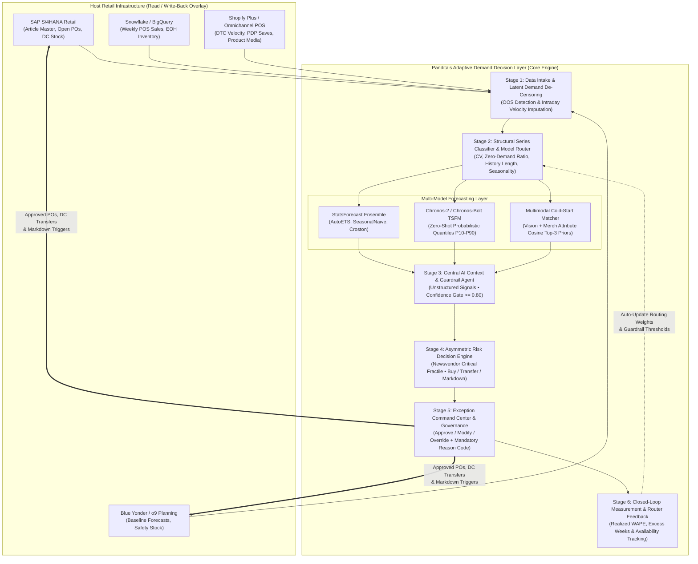

# Technical Documentation
## Pandita's Adaptive Demand Decision Layer (ADDL)

---

## 1. System Architecture Overview

**Pandita's Adaptive Demand Decision Layer (ADDL)** is architected as a modular, low-disruption intelligence overlay. It ingests transactional and merchandising data from existing enterprise systems, executes a 6-stage quantitative and agentic reasoning pipeline, and writes approved inventory actions back to the host ERP/planning environment.



---

## 2. Quantitative & Mathematical Formulations

### 2.1 Stage 1: Stockout De-Censoring ("True Latent Demand Recovery")
In retail POS data, observed sales $Y_t$ only equal true demand $D_t$ when inventory is available ($I_t > 0$). When a store or size stocks out ($I_t = 0$), observed sales are right-censored ($Y_t < D_t$). Training or conditioning any forecasting model on raw $Y_t$ creates a downward spiral of systematic under-forecasting.

ADDL's pre-processor reconstructs unconstrained latent demand $\hat{D}_t$ prior to model routing:

$$\hat{D}_t = \begin{cases} Y_t & \text{if } I_t > 0 \text{ (Unconstrained Week)} \\ \max\left(\alpha_{\text{intraday}} \cdot Y_t,\; \beta_{\text{cluster}} \cdot \tilde{Y}_{t,k}\right) & \text{if } I_t = 0 \text{ (Stockout-Censored Week)} \end{cases}$$

Where:
* $\tilde{Y}_{t,k} = \frac{1}{k}\sum_{j=1}^{k} Y_{t-j}$ is the local $k$-week rolling unconstrained velocity baseline ($k=4$).
* $\alpha_{\text{intraday}} \approx 1.48$ represents the intraday depletion multiplier derived from store traffic/PDP sessions during stockout hours.
* $\beta_{\text{cluster}} \approx 1.32$ scales against peer in-stock store doors within the same climate/tier cluster.
* The recovered lost units $\Delta Y_t^{\text{OOS}} = \hat{D}_t - Y_t$ are flagged on the Forecast Canvas so planners see exactly where legacy ERP baselines were distorted.

---

### 2.2 Stage 2: Series Classification & Intelligent Routing Logic
Rather than defaulting every SKU to a single heavy model, ADDL classifies each de-censored series $\hat{D}_{1:T}$ using four structural features:
1. **History Length ($T$):** Number of active selling weeks.
2. **Coefficient of Variation ($\text{CV}$):** $\text{CV} = \frac{\sigma(\hat{D})}{\mu(\hat{D})}$ after deseasonalization.
3. **Intermittency / Zero-Demand Ratio ($Z$):** Fraction of periods with low/intermittent store-level velocity.
4. **Promo Sensitivity ($\rho_{\text{promo}}$):** Lift ratio between promoted and non-promoted weeks.

| Series Archetype | Classification Criteria | Assigned Primary Model Route | LLM Context Gate |
| :--- | :--- | :--- | :--- |
| **Established Core** | $T \ge 52,\; \text{CV} < 0.18,\; Z < 0.05$ | `StatsForecast (AutoETS)` + `Chronos-2` Ensemble | Strict ($\ge 0.85$ conf) |
| **Promotional** | $\rho_{\text{promo}} \ge 1.35$ or upcoming campaign | `Chronos-2 Probabilistic` ($P_{10}$–$P_{90}$) + Context Agent | Active ($\ge 0.80$ conf) |
| **Seasonal** | High seasonal amplitude or window $W \le 10$ wks | `Chronos-2 Regime Decay` + Weather/Window Agent | Active ($\ge 0.80$ conf) |
| **Cold-Start Launch** | $T < 4$ weeks of POS history | `Multimodal Look-Alike Cosine Prior` $\rightarrow$ `Chronos-2 Zero-Shot` | Active ($\ge 0.80$ conf) |
| **Long-Tail** | $Z \ge 0.25$ or fragmented store-level tail | `Chronos-2 Cross-Learning Quantiles` (Pooled DTC) | Blocked (0% LLM adjust) |

---

### 2.3 Stage 3: Central AI Context Reasoning & Selective Guardrail
Unstructured signals (marketing calendars, social PDP velocity spikes, regional NOAA weather anomalies, port/ASN delays, competitor stockouts) are evaluated by the Central AI Agent ([`backend/server.py`](file:///Users/pb/retail-tsfm/backend/server.py)).

To prevent hallucinated forecast volatility, the agent is constrained by a **Selective Governance Guardrail**:

$$\hat{Q}_{t+h}^{(p), \text{ADDL}} = \begin{cases} \hat{Q}_{t+h}^{(p), \text{TSFM}} \cdot \left(1 + \delta_{\text{LLM}} \cdot \omega_h\right) & \text{if } C_{\text{LLM}} \ge \tau_{\text{archetype}} \\ \hat{Q}_{t+h}^{(p), \text{TSFM}} & \text{if } C_{\text{LLM}} < \tau_{\text{archetype}} \text{ (Guardrail Held at } 0\% \text{)} \end{cases}$$

Where:
* $\hat{Q}_{t+h}^{(p), \text{TSFM}}$ is the base Chronos-2 quantile forecast for quantile $p \in [0.10, 0.90]$ at horizon step $h \in \{1,\dots,12\}$.
* $\delta_{\text{LLM}} \in [-0.35, +0.45]$ is the bounded context adjustment percentage proposed by the Central AI Agent.
* $C_{\text{LLM}} \in [0, 1]$ is the agent's evidence confidence score.
* $\tau_{\text{archetype}} = 0.80$ ($0.85$ for Established Core) is the mandatory governance threshold.
* $\omega_h$ is a horizon decay weight ($1.0$ for weeks $1\text{–}6$, decaying to $0.55$ for weeks $7\text{–}12$).

---

### 2.4 Stage 4: Asymmetric Risk & Newsvendor Quantile Target ($P^*$)
Point forecasts ($P_{50}$) assume symmetric loss between over-ordering and under-ordering. In retail, loss is highly asymmetric:
* **Underage Cost ($C_u$):** Lost gross margin per unit $(P_{\text{retail}} - C_{\text{unit}})$ plus customer churn penalty.
* **Overage Cost ($C_o$):** Inventory holding cost over remaining selling window $W$ plus end-of-season clearance markdown loss $(C_{\text{unit}} - V_{\text{salvage}})$.

ADDL computes the optimal **Target Service Quantile ($P^*$)** via the Newsvendor critical fractile:

$$P^* = \frac{C_u}{C_u + C_o}$$

* **High-Margin Promotional / Core Styles:** $C_u \gg C_o \implies P^* \in [P_{80}, P_{85}]$. The engine recommends **Buy Expansions** or **Lateral DC-to-Store Transfers** to protect availability.
* **End-of-Season / Short-Window Fashion Styles ($W \le 6$ weeks):** $C_o$ rises sharply due to imminent clearance risk $\implies P^* \in [P_{35}, P_{45}]$. The engine recommends **Open PO Reductions** and **Early Shallow Markdowns (15% off in Week +2)** using price elasticity ($\epsilon \approx -2.4$) to clear inventory before forced 55% liquidation.

---

### 2.5 Multimodal Cold-Start & Size-Curve Optimization
For new seasonal launches ($T < 4$ weeks), ADDL constructs a unified embedding vector $\mathbf{v}_{\text{new}} = [\mathbf{v}_{\text{vision}} \;\|\; \mathbf{v}_{\text{merch}}] \in \mathbb{R}^{512}$ encoding silhouette, upper material texture, color palette, MSRP tier, and launch season.
1. **Top-$K$ Historical Analog Retrieval:** Computes cosine similarity against historical seasonal launches:
   $$\text{sim}(\mathbf{v}_{\text{new}}, \mathbf{v}_i) = \frac{\mathbf{v}_{\text{new}} \cdot \mathbf{v}_i}{\|\mathbf{v}_{\text{new}}\| \|\mathbf{v}_i\|}$$
2. **Zero-Shot Trajectory Conditioning:** The top 3 historical launch velocity curves (weighted by similarity scores $w_1, w_2, w_3$) condition the Chronos-2 zero-shot trajectory.
3. **Size-Curve Depletion Re-Weighting:** Adjusts size-level buy percentages (US 5.5 to US 10.0) away from flat historical averages toward observed early depletion in core sizes (US 7.0, 7.5, 8.0).

---

## 3. Backend API Specification (`backend/server.py`)

The FastAPI backend runs on `http://localhost:8005` and exposes four primary JSON endpoints:

### `GET /api/ai-status`
Returns the health status of the pre-loaded `amazon/chronos-bolt-tiny` model, configured Central AI reasoning model, and `.env` status.

```json
{
  "status": "online",
  "openrouterConfigured": true,
  "maskedKey": "sk-or-v1-...9f2a",
  "openrouterModel": "google/gemini-2.5-flash",
  "chronosModel": "amazon/chronos-bolt-tiny",
  "chronosStatus": "READY (amazon/chronos-bolt-tiny)",
  "envFilePath": "/Users/pb/retail-tsfm/.env"
}
```

### `POST /api/config`
Persists API credentials and the selected reasoning model to `/Users/pb/retail-tsfm/.env` and executes a live verification handshake.
* **Request Body:**
  ```json
  {
    "openrouterApiKey": "sk-or-v1-...",
    "openrouterModel": "anthropic/claude-3.7-sonnet",
    "testConnection": true
  }
  ```

### `POST /api/agent/what-if`
Executes the full quantitative + Central AI reasoning loop for a SKU:
1. Runs stockout de-censoring and `Chronos-Bolt` ($P_{10}, P_{50}, P_{90}$) + `StatsForecast` inference on the SKU's historical POS series.
2. Evaluates the planner's What-If parameters (`whatIfQuantile`, `whatIfPromoLiftPct`, `whatIfMarkdownPct`) and unstructured event prompt (`customEventPrompt`) via the Central AI Agent.
3. Returns the structured decision packet:
```json
{
  "llmProviderUsed": "Central AI Engine (gemini-2.5-flash)",
  "tsfmEngineUsed": "Chronos-Bolt (amazon/chronos-bolt-tiny)",
  "totalLatencyMs": 482.4,
  "localForecast": {
    "recoveredUnitsTotal": 185,
    "chronosP10": [580, 610, 890, "..."],
    "chronosP50": [690, 730, 1080, "..."],
    "chronosP90": [810, 860, 1290, "..."]
  },
  "decision": {
    "llmAdjustmentPct": 14.5,
    "llmConfidence": 0.91,
    "guardrailStatus": "APPROVED_BY_GUARDRAIL",
    "recommendedTargetQuantile": 85,
    "actionType": "DC_TRANSFER",
    "recommendedUnitsDelta": 1560,
    "recommendedMarkdownPct": 0,
    "actionTitle": "Expedite 640 Units DC-West → Coastal Cluster + Raise PO #8841 by +920 Units",
    "executiveRationale": "...",
    "riskTradeoffSummary": "Underage margin loss is $40.45/unit vs. overage holding/salvage cost of $6.83/unit (optimal Newsvendor critical fractile = P86).",
    "erpExecutionSteps": [
      "Write +14.5% context-adjusted forecast to SAP S/4HANA / Blue Yonder plan",
      "Release +640 unit lateral STO transfer from Rialto DC-West to 18 Coastal doors",
      "Expand open vendor PO #8841 by +920 units for W+2 receipt"
    ]
  }
}
```

### `POST /api/agent/copilot`
Powers the Natural Language Merchandising Copilot, grounding responses in the live 168-SKU portfolio summary and active SKU telemetry.

---

## 4. Enterprise Data & ERP Connector Specification

### 4.1 Canonical BYOD CSV Ingestion Schema (14 Columns)
Retailers can validate historical data immediately via the **Data Ingestion & ERP Connectors** tab using the following canonical CSV schema:

| Column Name | Type | Description | Example |
| :--- | :--- | :--- | :--- |
| `sku_id` | `string` | Unique style-color or SKU identifier | `TOMS-8101-SAN` |
| `sku_name` | `string` | Human-readable product description | `Women's Santiago Linen Espadrille Mule` |
| `category` | `string` | Department or category name | `Women's Footwear` |
| `archetype` | `enum` | `Promotional`, `Seasonal`, `Cold-Start`, `Established Core`, `Long-Tail` | `Promotional` |
| `retail_price` | `float` | Full-price MSRP ($) | `69.95` |
| `unit_cost` | `float` | Landed COGS per unit ($) | `22.00` |
| `current_inventory` | `int` | Current on-hand inventory units across network | `1180` |
| `on_order_units` | `int` | Open committed purchase order units | `600` |
| `lead_time_weeks` | `int` | Replenishment or transit lead time (weeks) | `2` |
| `remaining_selling_weeks` | `int` | Weeks remaining before seasonal exit/markdown | `10` |
| `base_weekly_demand` | `float` | Average unconstrained weekly unit velocity | `430` |
| `promo_flag_w3` | `bool` | `1` if promotion scheduled in forward horizon, else `0` | `1` |
| `censored_oos_weeks` | `int` | Number of historical weeks with stockout censoring | `3` |
| `legacy_erp_wape` | `float` | Historical baseline WAPE (%) from existing ERP/planning tool | `35.4` |

### 4.2 Enterprise Adapter Protocols
* **Snowflake Data Cloud / BigQuery:** Read-only service principal or Secure Data Share querying `WEEKLY_SKU_STORE_POS`, `INVENTORY_ON_HAND_SNAPSHOT`, and `PROMO_MARKETING_CALENDAR`.
* **SAP S/4HANA Fashion & Retail:** OData v4 / BAPI adapters reading `MARA` (Article Master), `MARD` (Storage Location Stock), and `EKKO/EKPO` (Open POs), and writing approved Stock Transport Orders (STOs) and PO schedule-line adjustments.
* **Blue Yonder / o9 Solutions:** REST/CSV overlay importing baseline statistical forecasts and exporting approved quantile-targeted order proposals.
* **Shopify Plus & Omnichannel POS:** GraphQL Admin API ingesting real-time DTC velocity, PDP save velocity, and product imagery for multimodal cold-start matching.
